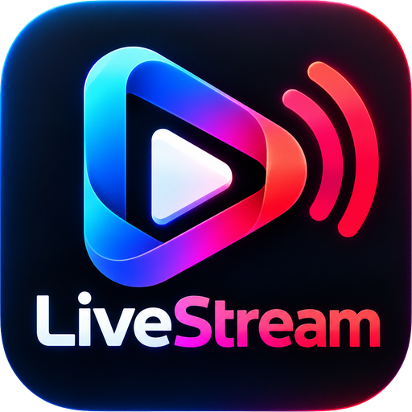

<p align="center">
  
</p>

<h1 align="center">LiveStream</h1>

<p align="center">
  Estudio de producción y transmisión en directo para Windows.<br />
  Motor <b>libobs</b> (el de OBS Studio) · interfaz en <b>Avalonia/.NET 10</b> · grafismo de TV · multistream ·
  <b>asistente de IA</b>
</p>

<p align="center">
  <a href="https://github.com/angelitosystems/LiveStream/releases"></a>
  <a href="LICENSE"></a>
  
  <a href="https://github.com/sponsors/angelitosystems"></a>
</p>

> Estado: versión **0.8.0**. Las siete fases del plan están implementadas y verificadas contra libobs real en
> Windows 11. Lo que no se ha podido probar (por ejemplo, emitir a plataformas reales sin credenciales) está detallado
> en [docs/ESTADO.md](docs/ESTADO.md). Los cambios de cada versión están en [CHANGELOG.md](CHANGELOG.md).

## Qué hace

- **Estudio tipo OBS**: escenas, fuentes compartidas entre escenas (pantalla, ventana, juego, cámara, micrófono, audio
  del sistema, imagen, presentación, video, texto, color), editor visual del lienzo (mover, escalar, recortar, girar,
  guías magnéticas, zoom), mezclador con medidores, modo estudio (vista previa + programa), deshacer/rehacer de todo.
- **Producción de TV**: transiciones (fundido, barrido, deslizamiento, cortinilla luma, fundido a color, stinger en
  video) y transición propia por escena; filtros de audio (supresión de ruido, puerta, compresor, limitador…) y video
  (color, croma, máscara…); capa de gráficos sobre el programa con 8 plantillas (rótulo, titular, cintillo, cuenta
  atrás, reloj, marcador, mosca EN VIVO, alerta), animaciones por fotogramas clave sincronizadas con el motor, edición
  en directo, plantillas reutilizables y datos en vivo desde archivo JSON.
- **Grabación y multistream**: MKV/MP4/MOV/FLV; emisión RTMP/RTMPS a varios destinos a la vez (YouTube, Twitch,
  Facebook, Kick, TikTok, relay propio o servidor personalizado) con codificador compartido, clave cifrada por destino,
  reconexión automática y supervisión por destino.
- **Optimización**: detección de CPU/GPU/codificadores, benchmark real de codificadores, perfiles recomendados (se
  aplican solo con autorización) y bitrate adaptativo determinista con registro de cada decisión.
- **Asistente de IA** (Claude, de Anthropic): crea escenas, añade fuentes, ajusta audio, lanza gráficos… con
  herramientas validadas; emitir, detener la emisión o borrar piden confirmación. Necesita una clave de API de
  Anthropic (se guarda cifrada en el equipo).

## Instalar

Descarga `LiveStream-Setup-0.8.0.exe` de la sección [Releases](https://github.com/angelitosystems/LiveStream/releases)
y ejecútalo. Un asistente te guía en cuatro pasos (bienvenida, opciones, instalación y listo): eliges la carpeta y si
quieres acceso en el menú Inicio y en el escritorio. Instala solo para tu usuario (no pide administrador) en
`%LOCALAPPDATA%\Programs\LiveStream` y se desinstala desde «Aplicaciones instaladas». También hay un `.zip` portable.

Instalación desatendida: `LiveStream-Setup-0.8.0.exe /quiet [/dir <carpeta>] [/noshortcuts]` (detalles en
[docs/DISTRIBUCION.md](docs/DISTRIBUCION.md)).

Requisitos: Windows 10/11 x64 y una GPU con Direct3D 11. El instalador no está firmado con Authenticode, así que
Windows SmartScreen puede mostrar un aviso.

Tus proyectos, ajustes y claves cifradas se guardan en `%APPDATA%\LiveStream` y se conservan al desinstalar o
actualizar.

## Compilar desde el código

Requisitos: Windows x64, .NET SDK 10, Visual Studio 2022 con herramientas de C++ (CMake), PowerShell 7 y **OBS Studio
32.2.2 instalado** (el modo de desarrollo toma de ahí los binarios de libobs; los headers se descargan del tag 32.2.2).

```powershell
./scripts/build-native.ps1        # puente nativo livestream_bridge + runtime de libobs en artifacts/obs-runtime
dotnet build LiveStream.sln
dotnet test LiveStream.sln        # pruebas unitarias + integración contra libobs real (necesita GPU y escritorio)
dotnet run --project src/LiveStream.Desktop
```

Para generar el instalador, el paquete portable y los símbolos:

```powershell
./scripts/package.ps1             # resultado en artifacts/release
```

Más detalles (actualizaciones firmadas, firma de código, prueba de resistencia) en
[docs/DISTRIBUCION.md](docs/DISTRIBUCION.md).

## Estructura

| Carpeta | Contenido |
|---|---|
| `native/livestream-bridge` | Puente C/C++ sobre libobs con una ABI C estable (motor, escenas, fuentes, filtros, animación, salidas, displays) |
| `src/LiveStream.Domain` | Modelo del estudio: proyecto, escenas, fuentes, gráficos, destinos, animaciones |
| `src/LiveStream.Application` | Casos de uso: comandos con deshacer, sesión, gráficos, multistream, optimización, herramientas del asistente |
| `src/LiveStream.Infrastructure` | Persistencia (`.spproj`), claves cifradas con DPAPI, registro, cliente de Claude, actualizaciones firmadas |
| `src/LiveStream.Native` | Interop .NET con el puente nativo |
| `src/LiveStream.Desktop` | Aplicación Avalonia |
| `tests/` | Pruebas unitarias y de integración contra libobs real |
| `tools/LiveStream.Setup` | Instalador por usuario (asistente en Avalonia; modo `/quiet` sin interfaz) |
| `Assets/` | Logo e icono originales; `Assets/generated` tiene las versiones con fondo transparente y el `.ico` |
| `tools/LiveStream.Soak` | Prueba de resistencia de larga duración |
| `scripts/` | Compilación nativa, empaquetado, firma de actualizaciones, inventario de licencias, automatización de la UI |

Toda modificación del estudio (desde la interfaz, el asistente o el optimizador) pasa por un único ejecutor de
comandos que valida, serializa y permite deshacer.

## Seguridad

- Las claves de transmisión y la clave de API se guardan cifradas con DPAPI para tu usuario de Windows; nunca se
  escriben en el proyecto ni en los registros.
- El asistente no puede elegir archivos, no ve servidores ni claves y no accede al motor directamente.
- Las actualizaciones solo se aceptan si el manifiesto está firmado (ECDSA P-256) y el instalador coincide con el
  tamaño y SHA-256 firmados.

## Licencia

LiveStream es software libre: puedes redistribuirlo y modificarlo según los términos de la **GNU General Public
License, versión 2 o (a tu elección) cualquier versión posterior** (GPL-2.0-or-later), la misma licencia que libobs.
El texto completo está en [LICENSE](LICENSE). Se distribuye **sin ninguna garantía**.

Si redistribuyes el instalador o el paquete portable, ofrece también el código fuente de esa versión (este repositorio,
en su tag). Los componentes de terceros y sus licencias están en
[docs/THIRD-PARTY-NOTICES.md](docs/THIRD-PARTY-NOTICES.md).

© 2026 Angel Calderon Mantilla.

## Auspicia LiveStream

LiveStream es un proyecto independiente. Si te resulta útil:

- **Personas**: apóyalo en [GitHub Sponsors](https://github.com/sponsors/angelitosystems).
- **Marcas y empresas**: escríbenos en las [Discusiones del repositorio](https://github.com/angelitosystems/LiveStream/discussions);
  tu marca aparecerá en el instalador y en esta página.

El instalador muestra estos mismos enlaces (se cambian en `tools/LiveStream.Setup/Sponsorship.cs`).
